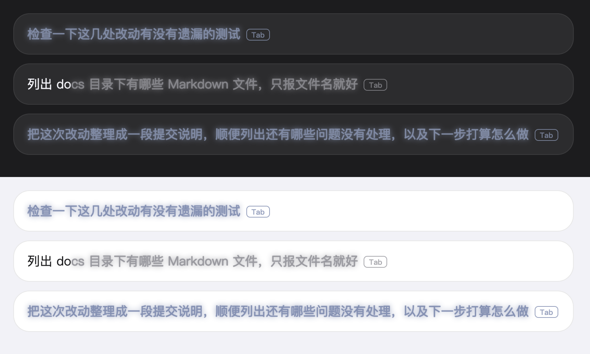

# dsh-foresight

**English** | [简体中文](README.md)

[](LICENSE)

A composer add-on for DeepSeek Harness (DSH) Web. After each turn it predicts your next message and shows it as grey ghost text (Tab to accept), completes what you type from session history, appends a one-line recap per turn, and lets ↑/↓ walk back through prompts you sent earlier.



> Style preview rendered in a browser with the real CSS from the build; theme variables are estimates, so this is not a screenshot of the desktop app. In each theme rows one and three are model predictions (slightly blue-grey), row two is a history completion.

## Features

| Feature | When | What it does |
|---|---|---|
| **Next-message prediction** | A turn finished, draft empty | Runs one request on a short-lived branch of the parent session and shows the likely next message as ghost text. The model may abstain. It inherits the parent session's model route and reasoning effort; no extra configuration needed. |
| **History prefix completion** | Draft not empty | Like zsh autosuggestions: scores past messages by recency, in-session frequency and cross-session hotness, and completes the rest. Local only, no model call. |
| **Turn recap** | A turn completed | One `🐳: …` line (≤ 80 chars) saying what changed in this turn. Persisted across restarts; turns with no change show nothing. Can be turned off on its own. |
| **Hotness management** | Settings | Cross-session frequent phrases; pin, delete or add by hand. |
| **↑/↓ recall** | ↑ with an empty draft | Walks back through prompts sent in this session; ↓ walks forward and restores the original draft. At the oldest loaded entry it asks the host for one more page of history. |

**Tab** accepts the whole suggestion, **→** accepts one word at a time (key is configurable). A small keycap at the end of the ghost text shows the accept key; model predictions carry a slight blue-grey tint while history completions keep the plain grey. Keys are not intercepted while an IME is composing.

**When ↑/↓ recall takes the key**:
- ↑ only with an empty draft; with text in the draft, ↑/↓ stay with the slash and `@` menus.
- ↓ only while already browsing; otherwise it stays with the editor's cursor.
- Never with Ctrl / Meta / Alt / Shift, during IME composition, or when the event target is outside this composer.
- Only your own messages, adjacent duplicates collapsed, at most 200 entries; after the oldest entry ↑ is swallowed instead of moving the caret to line start.

## Install

Requires DSH 0.2.x (load verified on 0.2.1-rc.5, see "Verified" below).

```bash
dsh plugin --profile web add dsh-foresight
```

The desktop app's `desktop` profile is managed by the app itself, so the CLI refuses to edit it; install from the app's plugin page, or add the package by hand to that profile's `dependencies` and `dsh.profile.bundles`.

From source:

```bash
git clone https://github.com/overFloweee/dsh-foresight.git && cd dsh-foresight
pnpm install
pnpm run build
pnpm pack                                   # produces dsh-foresight-0.1.0.tgz
dsh plugin --profile web add ./dsh-foresight-0.1.0.tgz
```

Restart dsh and hard-refresh the page. Do not add the working directory as a `file:` dependency: pnpm hard-links `file:` packages, so every later `build` overwrites the installed copy.

## Cost and privacy

- Every completed turn costs one extra model call for the prediction, and one more for the recap (output capped around 80 characters). Turn either off in settings.
- Only the last exchange is sent. Eight common secret shapes (AWS, OpenAI, GitHub, Slack, Stripe, JWT, private keys, Bearer tokens) are masked first. The recap only sees the current turn.
- Model output is stripped of control sequences, bidi overrides and code fences; unacceptable replies are dropped.
- Recap text and the hotness table are stored in the local DSH storage directory.

## Verified and not verified

Verified (2026-11-06): typecheck and build pass; 27 recall unit tests, the smoke tests and 7 end-to-end scripts pass. With DSH 0.2.1-rc.5 in an isolated `DSH_HOME`, the profile composes without a peer error and the browser half loads with no "Failed to load plugins".

After publishing to npm (2026-11-12), `dsh plugin --profile web add dsh-foresight` installed it into a fresh isolated profile, and the web UI loaded with no "Failed to load plugins".

Not verified: prediction quality, hit rate and latency with a real model; real-UI key handling of ↑/↓ recall (needs a session with history, and the isolated home has no model credentials); Windows and Linux; DSH 0.2.2 and 0.1.x kernels (the old peer ranges are kept but not re-run here).

## Known limits

- After a restart the last prediction is regenerated; history completion and hotness are available immediately.
- ↑/↓ recall reads a bounded window projected by the host, not the full log; very tool-heavy sessions may need several ↑ presses.
- ↑/↓ recall relies on the `data-composer-card` attribute on the composer card (a non-public host contract). If the host stops providing it, recall falls back to an ancestor-based scope and warns in the console. `pnpm run probe:host` scans the installed desktop app for it (still present on 0.2.2-rc.1 on 2026-11-06).
- ↑/↓ recall has no separate switch yet.
- Forked from dsh-suggest-ghost 0.4.1; later upstream changes (such as pause-triggered continuation) are not merged.
- Do not enable it together with `dsh-suggest-ghost` (duplicate ghost layers) or `dsh-session-companion` (both handle ↑/↓).

## Development

```bash
pnpm install
pnpm run typecheck
pnpm run build          # tsc + esbuild; lib/ is committed for github: installs
pnpm test               # recall unit tests
pnpm run test:smoke
pnpm run test:e2e
pnpm run probe:host     # check host DOM contract (needs the desktop app installed)
```

See [docs/prediction-notes.md](docs/prediction-notes.md) (Chinese) for configuration details and kernel-compatibility notes.

## License

MIT. Based on [dsh-suggest-ghost](https://github.com/dsh-plugin-collection/dsh-suggest-ghost) by WuJiaoJue; see [NOTICE.md](NOTICE.md).
