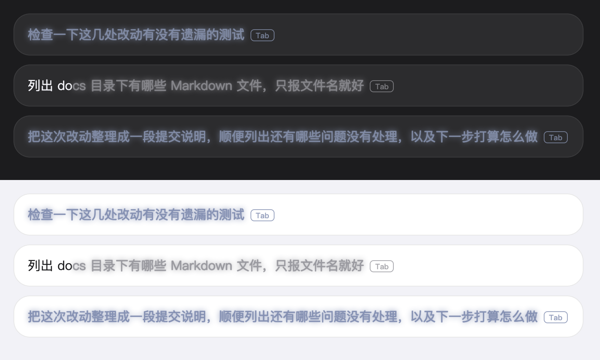

# dsh-foresight

[English](README.en.md) | **简体中文**

[](LICENSE)

DeepSeek Harness（DSH）Web 输入框增强插件。回合结束后预测你的下一句话，以灰色幽灵文本显示在输入框里，Tab 采纳；输入时按会话历史补全；每轮结束追加一行回顾；草稿为空时 ↑/↓ 翻本会话发过的提示词。



> 样式预览：用构建产物里的真实 CSS 在浏览器中渲染，主题变量为估计值，不是桌面端实机截图。每组第一、三条是模型预测（带一点蓝灰），第二条是历史补全。

## 功能

| 功能 | 触发 | 说明 |
|---|---|---|
| **下一句预测** | 回合结束，草稿为空 | 在父会话的短作用域分支上请求一次模型，产出你大概率会输入的下一句，显示为灰字。模型可以弃权（不显示）。默认继承主会话的模型路由和推理档，不需要额外配置。 |
| **历史前缀补全** | 草稿非空 | 类似 zsh autosuggestions：按新近度、会话内频次和跨会话热度给历史消息打分，补出剩余部分。本地计算，不调用模型。 |
| **回合回顾** | 回合完成 | 一行 `🐳：…`，80 字内说明这一轮之后什么变了。重启后仍在，没有变化的回合不显示。可单独关闭。 |
| **热度管理** | 设置页 | 跨会话高频短语列表，可固定、删除、手工添加。 |
| **↑/↓ 召回** | 草稿为空时按 ↑ | 翻本会话发过的提示词，↓ 往回翻并还原原草稿。翻到已加载窗口最早一条时，会向宿主再要一页更早的历史。 |

采纳方式：**Tab** 整条采纳，**→** 逐词采纳（采纳键可在设置里改）。灰字末尾有一个小键帽提示当前的采纳键；模型预测的建议在灰色基础上带一点蓝灰，历史补全保持原来的灰。中文输入法组词期间不拦截按键。

**↑/↓ 召回的接管条件**：
- ↑ 只在草稿为空时接管；草稿非空时 ↑/↓ 留给斜杠菜单和 `@` 引用菜单。
- ↓ 只在已经处于浏览中时接管，否则留给编辑器移动光标。
- 带 Ctrl / Meta / Alt / Shift 的组合键、输入法组词期间、事件目标不在本输入框内时，都不接管。
- 只认用户消息，相邻重复只保留一条，最多 200 条；翻到最早一条后继续按 ↑ 会吃掉按键，不会把光标移到行首。

## 安装

要求：DSH 0.2.x 系列（在 0.2.1-rc.5 上验证过加载，见下方「已验证」）。

```bash
dsh plugin --profile web add dsh-foresight
```

桌面端的 `desktop` profile 由应用自己管理，命令行不能直接改，请在应用的插件页安装，或手工把包加到该 profile 的 `dependencies` 和 `dsh.profile.bundles`。

从源码安装：

```bash
git clone https://github.com/overFloweee/dsh-foresight.git && cd dsh-foresight
pnpm install
pnpm run build
pnpm pack                                   # 生成 dsh-foresight-0.1.0.tgz
dsh plugin --profile web add ./dsh-foresight-0.1.0.tgz
```

装完重启 dsh，浏览器强制刷新。不要直接把开发目录写成 `file:` 依赖：pnpm 对 `file:` 做硬链接，之后每次 `build` 会同时改掉已安装的副本。

## 设置

Settings → Plugins 里的卡片，保存后即时生效，界面语言跟随 DSH。

| 分组 | 可调项 |
|---|---|
| LLM 下一条建议 | 开关、输出令牌上限、超时、采纳快捷键 |
| 回合回顾 | 开关；字数上限、材料预算、超时通过 `cordis.patch.yml` 覆盖 |
| 历史前缀补全 | 开关、跨会话搜索、最大历史条数、最少输入字符、逐词采纳 |
| 热度管理 | 固定、删除、新增、清空 |

完整配置项和默认值见 [docs/prediction-notes.md](docs/prediction-notes.md)。

## 成本与隐私

- 每个完成的回合会多调用一次模型生成预测；开启回顾后再多一次，输出上限约 80 字。不需要时在设置里关闭。
- 发给模型的只有最近一轮对话，发送前会遮蔽 8 类常见密钥形状（AWS、OpenAI、GitHub、Slack、Stripe、JWT、私钥、Bearer）。回顾只取当前回合的材料。
- 模型输出会剥离控制序列、双向覆盖符和代码围栏，不合格的回复直接丢弃。
- 回顾文本和热度表保存在本地 DSH 的 storage 目录。

## 已验证与未验证

已验证（2026-11-06）：
- 类型检查和构建通过；召回的 27 条单元测试、冒烟测试和 7 组端到端脚本通过。
- 在隔离的 `DSH_HOME` 里，用 DSH 0.2.1-rc.5 装入并启动 web：profile 组装不报 peer 不兼容，浏览器端插件加载成功且页面没有 “Failed to load plugins”。
- 2026-11-12 发布到 npm 后，在全新的隔离 profile 里用 `dsh plugin --profile web add dsh-foresight` 一行命令安装，启动 web 后页面加载正常，没有 “Failed to load plugins”。

未验证：
- 真实模型下的预测质量、命中率和延迟。
- ↑/↓ 召回在真实界面里的按键行为（需要带历史的会话，隔离环境里没有模型凭据）。
- Windows、Linux；DSH 0.2.2 以及更早的 0.1.x 内核（peer 声明保留了旧范围，但没有在本仓库里重跑）。

## 已知限制

- 重启后上一条预测需要重新生成；历史补全和热度立即可用。
- ↑/↓ 召回读取的是宿主投影出的有界窗口，不是完整日志；上下文压力大时旧消息可能取不到，工具调用很密的会话需要多按几次 ↑。
- ↑/↓ 召回依赖宿主输入框卡片上的 `data-composer-card` 属性（非公开契约）。宿主不再提供时会降级为祖先范围判定并在控制台警告。`pnpm run probe:host` 会扫描已安装的桌面端核对它还在不在（2026-11-06 在 0.2.2-rc.1 上还在）。
- ↑/↓ 召回目前没有单独的开关；不想要就不要启用本插件，或与同样接管 ↑/↓ 的插件二选一。
- 分叉自 dsh-suggest-ghost 0.4.1，上游之后的改动（如停顿续写）没有合入。
- 不要与 `dsh-suggest-ghost` 同时启用，两者会重复注册幽灵层；也不要与 `dsh-session-companion` 同时启用，两者都会处理 ↑/↓。

## 开发

```bash
pnpm install
pnpm run typecheck      # 宿主半区类型检查
pnpm run build          # tsc + esbuild，产物在 lib/（已提交，供 github: 安装）
pnpm test               # ↑/↓ 召回的单元测试
pnpm run test:smoke     # 冒烟测试
pnpm run test:e2e       # 端到端
pnpm run probe:host     # 核对宿主 DOM 契约（需要已安装桌面端）
```

`src/` 是源码，`lib/` 是构建产物，直接改 `lib/` 会在下次构建时被覆盖。

## 许可与来源

MIT。基于 [dsh-suggest-ghost](https://github.com/dsh-plugin-collection/dsh-suggest-ghost)（WuJiaoJue），详见 [NOTICE.md](NOTICE.md)。
