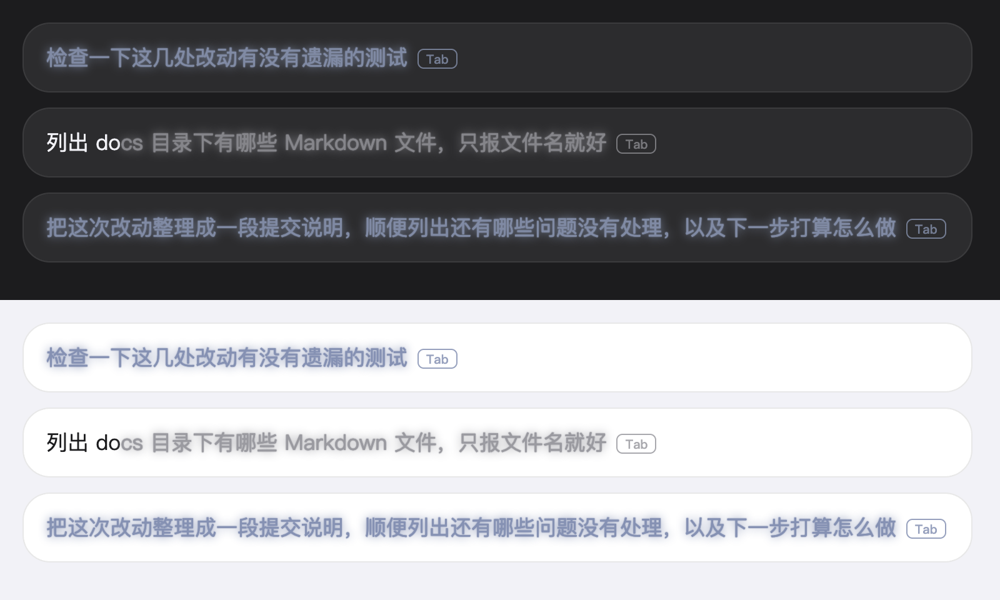

# 预测半区开发笔记

> 本文件由 dsh-suggest-ghost 的原 README 改写而来，保留其中的实现说明、内核兼容性记录与踩坑记录。面向用户的说明见仓库根目录 README。

## 这是什么

纯插件挂载（host 监听回合事件 + client 端 DOM overlay），不改 DSH 任何核心代码。两个模式自动切换：

- **LLM 下一条建议**（草稿为空）：每个回合完成后，在父会话的**短作用域预测分支**上跑一次请求——继承父会话完整有效消息面与父请求路由（provider / model / 推理档），追加官方同款提示词与 JSON schema，产出 `{suggestion: string|null}`；`null` 或空串记「模型明确弃权」（不是失败），非法 JSON / 工具调用 / 非正常结束记失败。分支在请求结束（成功、弃权、失败、超时、取消）后立即释放，父会话事件与磁盘日志不受影响；打开会话/重连时由 client 发 pull 触发补抓（catch_up），与 live 共用同一请求键，因此不会重复调用模型。
- **回合回顾**（独立开关）：回合完成（`turn/end` + `completed`）后再跑一次辅助调用，把这一轮「之后什么变了」压成一行 80 字内的人话（结论 / 现在的状态 / 还差什么）；没有变化的回合不显示。作为一行 `🐳：…` 渲染在助手最终回复之后、copy/fork 动作行之前（官方 `conversation.chat.turnTail` 槽）。按「会话 + 回合」落盘（`suggest_ghost_recap` 域），重启回看旧回合时仍在；不追加任何会话事件，也不改写磁盘日志。形态对齐 Claude Code 的 session recap，但**触发点是每个完成的回合**，不是「离开 3 分钟」。
- **历史前缀补全**（草稿非空）：zsh autosuggestions 式——从会话历史找前缀命中项，按新近度为主、会话内频次与跨会话热度为辅打分取最优，灰色显示剩余部分。全/半角标点、空白、大小写差异不影响匹配。

幽灵文本是 DOM overlay 近似渲染（跟随输入框字体、跟随滚动），不依赖官方 `setGhost` 输入机能力，rc.6 即可运行；中文输入法组合期间不拦截按键。

## 效果预览



深色文字 = 已输入；灰色 = 幽灵建议（模型预测的建议带一点蓝灰）。**Tab** 整条采纳，**→** 逐词采纳。幽灵文本跟随输入框字体与滚动渲染，不遮挡、不抢焦点；不合意就无视它，继续打字即消失——零成本。

## 配置

全部设置在 Settings → Plugins 面板的 Suggest ghost 卡片，保存后即时生效：
卡片文案（字段 label/hint、按钮、徽章）跟随宿主 DSH 界面语言（中文 / English），
设置页切换语言后实时跟随，无需刷新；旧宿主无 locale 服务时回退中文。

| 分组 | 字段 |
|---|---|
| LLM 下一条建议 | 启用开关、输出令牌上限、超时（毫秒）、采纳快捷键；预测**继承父会话模型与路由**（旧的 provider / model 路由降级为迁移期兼容字段，不再覆盖预测） |
| 回合回顾 | 启用开关；正文上限 `recapMaxChars`、材料预算 `recapSourceChars`、单次超时 `recapTimeoutMs` 走 `cordis.patch.yml` 覆盖 |
| 历史前缀补全 | 启用开关、跨会话搜索、最大历史条目、最少输入字符、逐词采纳 |
| 热度管理 | 跨会话高频短语列表：固定（不参与淘汰、候选恒置顶）、删除、手工新增（默认固定）、清空全部——即时生效，无需保存 |

也可以在 cordis.patch.yml 按 id 覆盖（作为上述项的初始值）：

```yaml
- id: dsh-foresight
  config:
    maxInputBytes: 4096        # 框架化用户提示字节上限
    maxOutputTokens: 8192      # 建议输出令牌上限（默认 8192：长会话在 2048 档会被写满 ⇒ 预测判失败、界面不出建议）
    timeoutMs: 60000           # 辅助请求截止时间（毫秒）
    maxRecentTurns: 1          # 送入建议模型的最近完成回合数
    maxTranscriptChars: 12000  # 转录字符预算
    maxSuggestionChars: 240    # 仅历史前缀补全的可见字符上限（预测不按长度截断）
    reasoningEffort: ''        # 预测请求推理档（low/high/max）；留空/省略 = 继承父会话档
    acceptKey: Tab             # 采纳快捷键
    llmEnabled: true           # LLM 建议开关
    recapEnabled: true         # 回合回顾开关（每轮结束后追加一行回顾）
    recapMaxChars: 80          # 回顾正文上限（字符）；超长按标点断句
    recapSourceChars: 12000    # 送给回顾模型的单回合材料预算（字符）
    recapTimeoutMs: 30000      # 单次回顾调用超时（毫秒）
```

`reasoningEffort` 默认**留空（继承父会话档）**：预测分支在父会话上下文里跑一次请求，
沿用父请求的 provider / model / 推理档最贴近官方行为，也避免插件替用户压低或抬高成本；
非空才覆盖，并在设置卡片里同时显示「父档 / 配置档 / 实际档」三档。
`maxOutputTokens` 默认 **8192**：长会话（工具史多、回合长）里模型会先写长文本再给 JSON，
2048 档实测被写满（`finish.kind: max-tokens`）导致预测直接判失败、界面什么都不显示。
另：预测不再使用 `maxInputBytes`、`maxRecentTurns`、`maxTranscriptChars`、`maxSuggestionChars`
——上下文来自父会话的完整有效消息面，输出只做 trim（长建议由展示层处理布局）。


## 回合回顾

每个完成的回合结束后，宿主在后台单独请求一次模型，把这一轮压成一行：

```
🐳：开关已加上，构建通过，还有 1 条测试失败
```

- **触发**：仅 `turn/end` 且 `reason.kind === 'completed'`；子代理会话、预测分支会话不生成；同一会话同一回合只生成一次。
- **输入**：只取这一回合的材料——用户诉求、助手结论、本轮工具调用（工具名 + 目标）与本轮工具错误，按 `recapSourceChars` 截断；材料末尾追加问句「这一轮之后，什么变了？」，把模型从「复述过程」扭到「说变化量」。提示词按用户定稿只保留三段：角色与读者 +「最高要求：逻辑清晰说人话，要解释给用户一次性就能够听明白」。
- **形状**：代码闸门兜底——剥掉「回顾这一轮：…」这类元叙述开头，按 `recapMaxChars`（默认 80 字）在标点处断句；模型判定「这一轮没有变化」时回哨兵，该回合静默不显示。
- **位置**：`conversation.chat.turnTail` 槽，渲染在助手最终文本之后、动作行之前；不带文字标签，只有 `🐳：` + 正文。
- **持久化**：`suggest_ghost_recap` 域（键为 `sessionId + turn`，单会话最多 50 条、全表 400 条），重启后由 client 的 pull 对账拿回，不依赖 `_push` 的历史值。
- **失败静默**：路由缺失、超时、传输错误、空正文、模型返回工具调用都只记 debug 日志、不显示该行，永远不影响主回合。
- **成本**：每回合多一次辅助调用（输出上限 80 字符）；不想用时把「启用回合回顾」关掉，已生成的回顾保留。
- **实现细节**（数据流、存储、失败归因、测试）：[回合回顾-技术方案.md](回合回顾-技术方案.md)

## 安全

- 只把最后一轮对话发给建议模型，发送前自动脱敏常见凭据；输出经净化，不合格回复静默丢弃
- 回合回顾只把**当前回合**的材料发给模型（自动脱敏），不读更早回合；回顾文本落盘在本地 profile 的存储域里
- 全程有界：输入字节 / 输出 token / 超时封顶；同回合防重入，新回合作废旧生成，卸载即中止在途请求

## 兼容性

五代内核均实测通过（`0.1.5` / `0.1.7` / `0.2.0` 为 2026-09-29 复测，其余为 2026-09-07）：

| DSH 内核 | peer 门禁 | host 入口链接 | 运行时符号 | 隔离 profile 装配 | 设置页可见 |
|---|---|---|---|---|---|
| `0.1.1-rc.2` | — | ✅ | ✅ 8/8 | ✅ | ✅ |
| `0.1.2-rc.1` | — | ✅ | ✅ 8/8 | ✅ | ✅ |
| `0.1.5-rc.3` | — | ✅ | ✅ 10/10 | ✅ | ✅ |
| `0.1.7-rc.2` | — | ✅ | ✅ 10/10 | ✅ | ✅ |
| `0.2.0-rc.2` | ✅ | ✅ | ✅ 10/10 | ✅ | ✅ |

### peer 枚举，以及 0.2.0 才开始有的硬门禁

peer 依赖写成 `^0.1.1-rc.2 || ^0.1.2-rc.1 || … || ^0.2.0-rc.2` 这种**逐代枚举**，而不是 `>=0.1.1-rc.2`：node-semver 默认不把预发布版算进任何范围，只有比较符带同一 `[major.minor.patch]` 元组时才放行，所以 `^0.1.1-rc.2` 对 `0.1.2-rc.1` 为假、`*` 同样为假 —— 跨代没有区间写法。**上游每发布一个新的 rc 代次，peer 就要补一个枚举项**。

**`0.2.0` 起这条从「安装期提示」升级为「加载期硬拒绝」**：内核在组装 profile 时逐条用
`semver.satisfies(runtimeVersion, range, { includePrerelease: true })` 校验 peer
（`dsh-app-boot` 的插件兼容性检查），不满足就整个 bundle 跳过：

```
dsh: skipping profile bundle "dsh-foresight": Error: Plugin … is incompatible
with dsh 0.2.0-rc.2: peerDependencies {…}
```

两点值得记住：

- 门禁用的是 **`includePrerelease: true`**，所以 `^0.2.0`（不带 rc）对 `0.2.0-rc.2` 判假，
  必须精确写 `^0.2.0-rc.2`；
- 需要临时放行时可以用 `dsh plugin allow-version` 给**精确版本**豁免，但那是绕过
  检查，不是修复 —— 正式做法仍是补枚举项。

### 0.1.7 的 settings 体系变更（源码里唯一的大改）

`0.1.7` 移除了整个 `settings.yaml` 体系，本插件的数据通道随之搬家：

| | `0.1.5` | `0.1.7+` |
|---|---|---|
| 用户可调项 | `ctx.settings.register(ns, schema, …)` 注册命名空间 | `Config` 里逐字段 `.volatile()`，内核把**插件自己的 Config schema** 投影成表单，ns = Loader 条目 id |
| host → client | `SettingsScope` 的 `_push` 字段 | `ctx.settings.update(ns, {_push})`（`_push` 标 volatile） |
| client 读取 | `settingsScope.bind(ns).get()` | `remote.settings.describe()`（首读 + 事件驱动重读）|
| client → host | `scope.set('_ops', …)` | `remote.settings.mutate(ns, [{op:'set',path:['_ops'],…}])` |
| 变更通知（host） | `scope.watch` | `settings/document-updated(ns, revision)` 事件 |
| 变更通知（client） | `scope.subscribe` | `remote.$on('settings/document-updated')` |

**载荷结构（`_push` / `_ops` 的 JSON 形态、含 `suggestionSessionId` / `historySessionId`
归属守卫）逐字未变**，变的只是字段载体，所以 client 的解析与归属逻辑不必改。

三处细节是踩过才知道的：

- **`Config` 不能整对象标 `.volatile()`**，也不能把 `z.object({…}).volatile().dict`
  摊平再 spread —— 前者会把策略参数一并暴露成表单，后者摊平时丢掉每个字段自己的
  `meta`，实测直接导致整张表单不可见。正确写法是**逐字段** `.volatile()`。
- **volatile 字段解析后是引用**（cosmokit 的 `Volatile<T>`），不是裸值，读值必须走
  `.get()`。因此加了一层 `flattenConfig()` 把引用拍平成裸值，上层代码对代次无感；
  它同时认得裸值形态，所以 0.1.5 及更早的代次照样工作。
- **`provider` / `model` 从 `z.string().min(1)` 改成 `.default('')`**：标进表单后
  必填会让插件「不填就不能启动」，而留空=继承主请求路由恰恰要求它是可选的。

### 其它跨代取舍

- **不用 `settingsNamespace()`**：该 helper 在 `0.1.2` 已被删除，运行时导入会让整个模块链接失败。它只是校验后原样返回 brand 字符串，故改用 `'dsh-foresight' as SettingsNamespace` 字面量断言。
- **不导入 `deepFreeze`**：`0.1.1` 由 `dsh-llm` 导出，`0.1.2` 把它迁到新增的 `dsh-util-values` 并停止转发，而该包在 `0.1.1` 内核中不存在 —— 换导入源只会反向破坏另一代，因此 `src/generate.ts` 自带一份等价实现（迭代遍历、循环引用安全、跳过 `AbortSignal`）。
- **client 端不从 `@deepseek-ai/dsh-client-runtime` 取类型**：该包是 `0.1.1` 内核特有，`0.1.2` 已拆走。`lib/client.js` 实测零内核导入（只需 `react`），跨代无关；`ctx.remote` 的最小面在 client 侧本地声明（见 `src/client/index.ts` 的 `RemoteLike`）。
- **`source.kind` 用 `'user'` 而非 `'plugin'`**：`0.1.7` 删了 `plugin` kind、新增的 `schedule` 在 `0.1.5` 又不存在，两代无交集，故取共有的 `user`。该字段只用于构造一次性 LLM 请求载荷，不参与持久化与投影。

### 已知取舍与限制

- **旧设置会迁移**：实测 `0.1.5` 时代改过的值（例如 `historyMaxEntries`）在 `0.2.0`
  上原样恢复——用户层保留在 profile 文档里，只是**运行期的 volatile 引用不落盘**，
  所以重启后读回的是 profile 里的持久值，而不是上次的内存值。
- **client 侧无轮询**：0.1.7 随 `settingsScope` 一起移除的只是 `scope.subscribe`，
  内核另有转发给 client 的事件通道 —— `ctx.remote.$on('settings/document-updated')`
  （在 dsh-api-remotes 的转发白名单内，mode `emit`）。内核自己的设置页即用它驱动
  `SettingsDescribeMirror`。本插件同款订阅，只在 host 真推 `_push` 时才发
  `describe()`，另在首读与 `connection/reset` 时各读一次。

### 复现方式

为待测内核建隔离 profile（`$DSH_HOME` 指向临时目录，`node_modules` 用 `cp -al` 硬链接对应内核树，避免向上解析撞到另一代的树），先 `dsh --profile <p> --dump-config` 校验 manifest 组装 —— **这一步在 0.2.0 上就会暴露 peer 门禁的拒绝**，再 `dsh --profile <p> "say hi"` 与 `dsh --profile <p> -- --no-open --port <p>` 观察插件加载。headless 启动停在 `MISSING_CREDENTIAL`（临时 home 无凭据），该点在插件加载之后。

## 开发

```
src/index.ts         host 入口：turn/end(completed) → 有界生成建议；Config（策略 + volatile 可编辑项）
src/coldstart.ts     冷启动语义（纯函数）：日志取环种子、回合语义校验、建议追踪
src/generate.ts      转录提取 → 脱敏 → ctx.llm.stream → 净化；flattenConfig 拍平 volatile 引用
src/transcript.ts    转录纯逻辑：字符 + UTF-8 字节双预算裁剪（纯函数，可单测）
src/sanitize.ts      脱敏 / 净化 / 语义过滤 / 截断（纯函数）
src/settings.ts      _push / _ops 载荷形状 + effectiveConfig（schema 在 index.ts 的 Config）
src/hotness.ts       跨会话热度表（增量去重、最小堆淘汰、内存上界、固定/管理 API）
src/hotness-store.ts 热度持久化（storageDomain 域、回合边界合并落盘、重启恢复合并、管理 ops 应用）
src/projection.ts    suggestGhost 投影 last-wins fold
src/client/          幽灵渲染、历史匹配、逐词切分、快捷键、设置卡片；
                    settings-scope.ts 是卡片 scope 最小面，index.ts 的 remoteSettingsScope() 适配
scripts/             冒烟测试与会话日志回放
```

### 冷启动语义（重启后为何立即可用）

重启后「没有数据」并非真的没数据：**历史在会话日志里，建议由 host 按语义校验后重推**。
所谓冷启动问题，本质是判据选错了——旧实现用「时间」（重启即作废、事件到达才播种）当判据，
于是留下两个空窗。现在统一改为**语义**判据：

- **历史环**是会话日志的缓存：pull 到达时未命中就从日志现算（`ringFor`），不存在「播种时机」，
  也就没有「pull 抢在首个事件之前 → 回空」的竞态。会话活跃期间由 `session/event` 增量维护。
- **建议**是否可用，取决于它对应的回合是否仍是该会话的最后一个已完成回合（`suggestionIsCurrent`）。
  host 每次组装状态都经这道校验：有效则原样恢复（打开页面即见上一轮建议，不等新回合）；
  可判定为陈旧则清场。
- 三条推送路径（pull 应答 / 回合结束 / 热度恢复补推）共用同一份状态组装（`statePushOf`），
  不再各写各的；client 侧 pull 统一在会话绑定成功处发起，冷启动、切会话、会话晚就绪三合一。
- 热度表恢复完成后（`whenReady`）补推一次完整快照，关掉「恢复窗口内推送了不完整频次」的窗口。

> **协议 v2（预测分支）之后**：`_push` 里落盘的 v2 载荷**不再**当作有效预测回读恢复——预测由
> host 的源回合投影（`{turn, endSeq, endKind}`）加 pull 的 catch_up 按需重建，避免把上一进程的
> 旧幽灵当成本进程的有效建议；同一源回合与同一生成配置身份共用一个请求键，命中终态记录
> （建议 / 明确弃权 / 失败 / 已采纳）就不再调模型，父会话新回合一开始立即作废旧记录。
> 历史前缀补全与热度恢复不受此改动影响。

> 与 0.1.5 的差别：那时 `_push` 落 `settings.yaml`，重启后可回读盘上残留的上一条建议；
> `0.1.7+` 的 volatile 字段不落盘，**重启后上一条建议需要重新生成**（新回合跑完即恢复）。
> 期间历史前缀补全与热度面板照常可用——它们走的是会话日志与 storage 域，不经 volatile。
> 注意区分：用户的**设置值**仍在 profile 文档里、照常迁移（见「已知取舍与限制」）。

```bash
pnpm run build       # tsc 编译 host + esbuild 打包 client → lib/
pnpm run test:smoke  # 纯函数冒烟测试（含热度持久化语义、冷启动语义）
pnpm run test:e2e    # 真实栈端到端：热度落盘→重启恢复；冷启动重启对账/pull 应答
pnpm run replay      # 用真实会话日志回放补全管线
```

## 已知限制

- 跨会话热度表已持久化（宿主 storage 域，落 `~/.dsh/storages/suggest_ghost_hotness.json`）：重启后频次恢复，不再从零累积；宿主无 storage 域（如极简 headless 组合）时自动降级为内存态，重启清零
- 升级到 `0.1.7+` 后旧设置不自动迁移（volatile 字段不落盘），需按默认值重设一次；详见上方「已知取舍与限制」
- 重启后历史补全与上一轮建议立即可用（判据是语义而非重启时机）；但**新回合**的建议仍需等该回合跑完才能生成——这是「预测下一条」的固有代价，不是启动延迟
- 热度管理面板显示并过滤的是推送的 top-K 快照（默认 50 条，「共 N 条」展示全量）；更大范围的主机侧搜索未做
- 删除只清当前统计——再次输入同文本会重新计入；「固定」才是不被淘汰的语义
- LLM 建议只覆盖当前会话；把其他会话文本并作候选需开启「跨会话搜索」
- 每个完成回合都会调一次建议模型（与输入框是否有内容无关），不需要时可在设置里关闭省 token

## 许可

MIT © wujue。安全与生成管线参考 [dsh-suggest-prompt](https://github.com/studyzy/dsh-suggest-prompt)（MIT）实现。


